# HVAC-DT-EnergySim
A digital twin-based central air conditioning system energy consumption simulation platform. It should enable hourly annual energy simulations and optimize design solutions/control strategies under full-year operating conditions.

这是一个基于数字孪生的中央空调系统能耗仿真平台，能够空调系统全年逐时能耗仿真，并能够基于全年运行工况下，优化空调系统设计方案和控制策略。

## 一、建筑冷负荷模拟计算
### 1、建筑简介
  建筑类型属于商业办公建筑，六层，为了简化计算，地下层和屋顶没有设置空调，建筑地理位置是北京市，建筑空调面积 2,931,000 m²（口径 v2 更正；此前误记为 2,931 m²，相差 1000 倍）。
### 2、建筑平面图
一层的建筑平面图：

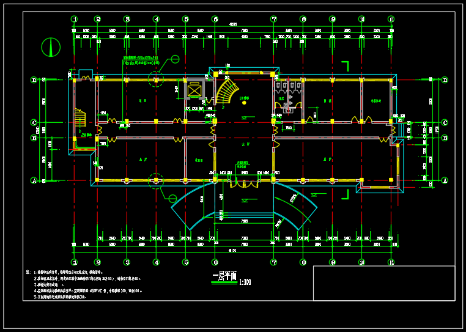

二层的建筑平面图：

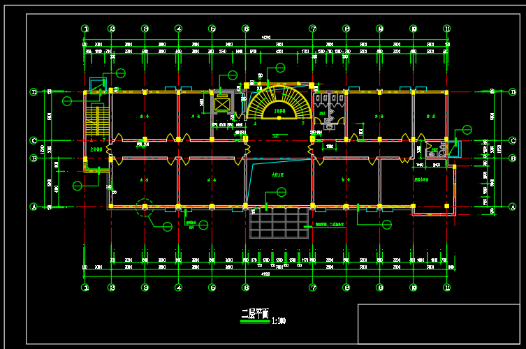

三层的建筑平面图：

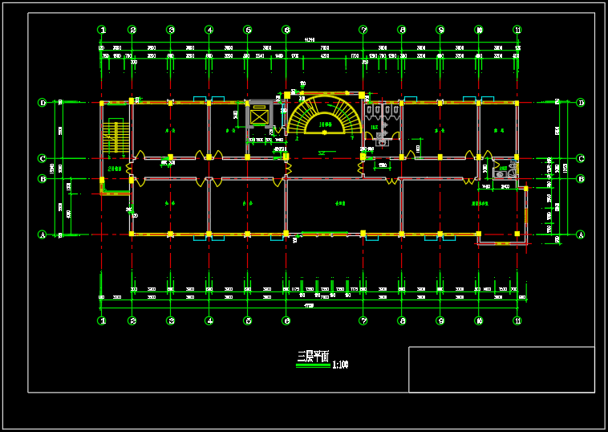

四、五层的建筑平面图：

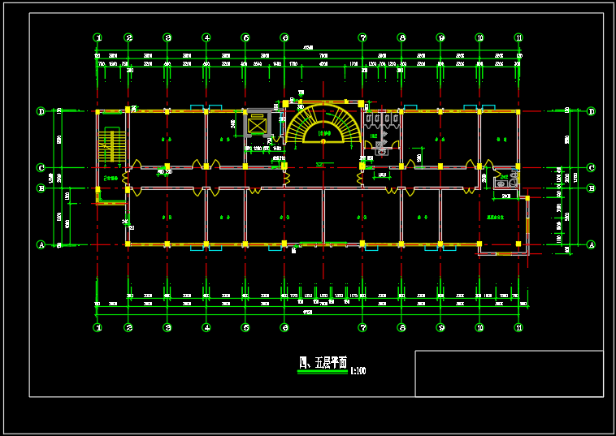

六层的建筑平面图：

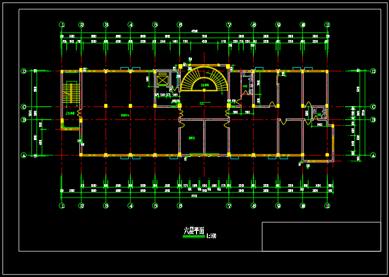

### 3、基于DeST软件的建筑模拟模型图
一层模型图：

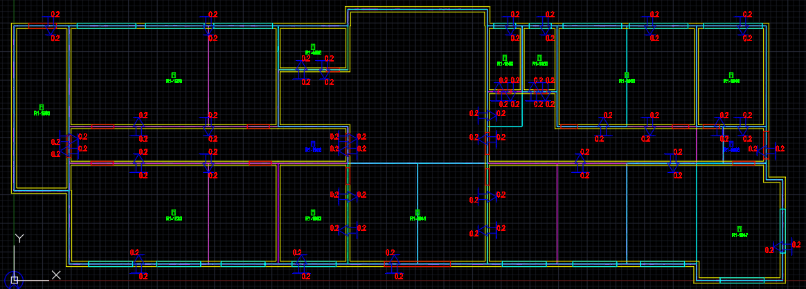

二层模型图：

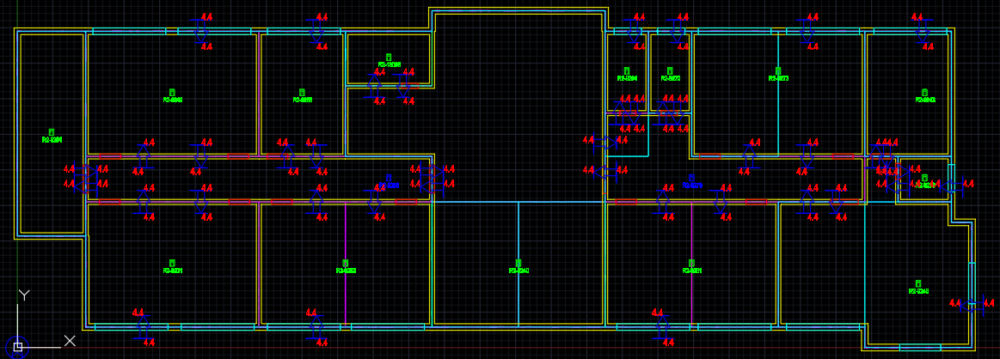

三层模型图：

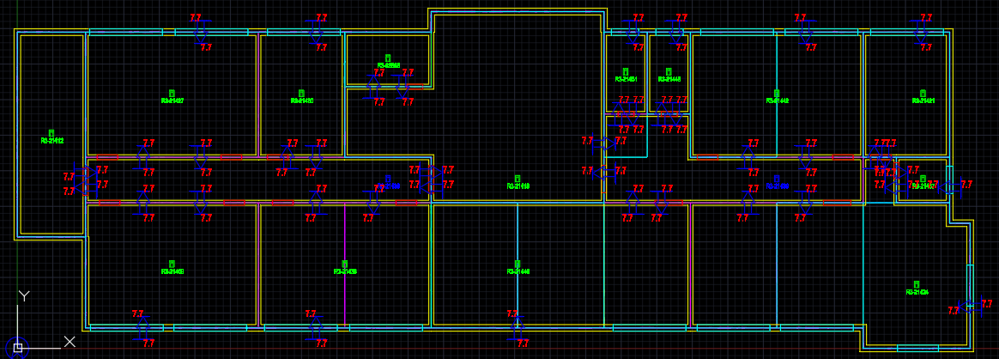

四、五层模型图：

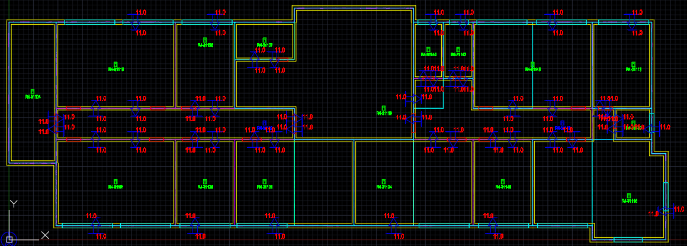

六层模型图：

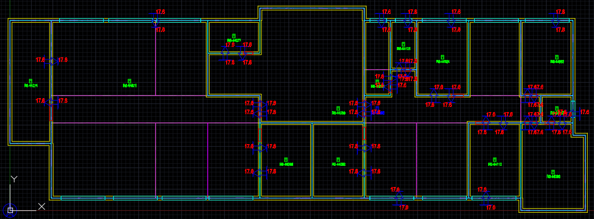

### 4、房间及围护结构设置
房间类型包括：楼梯间、展厅、大堂、密集办公室、办公室、设备间、休息室、卫生间等，房间作息和热扰均按照DeST软件内置参数，围护结构和门、窗等参数设置也是按照DeST软件内置参数。建筑模拟的全局设定如下图：

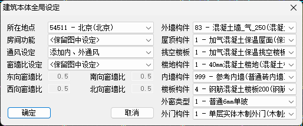

### 5、阴影和日影计算
使用DeST软件自带的阴影计算模块和日影计算模块进行全年的太阳辐射影响的计算，计算结果如下图：
1、5月22日 正午12时的阴影计算分析结果：

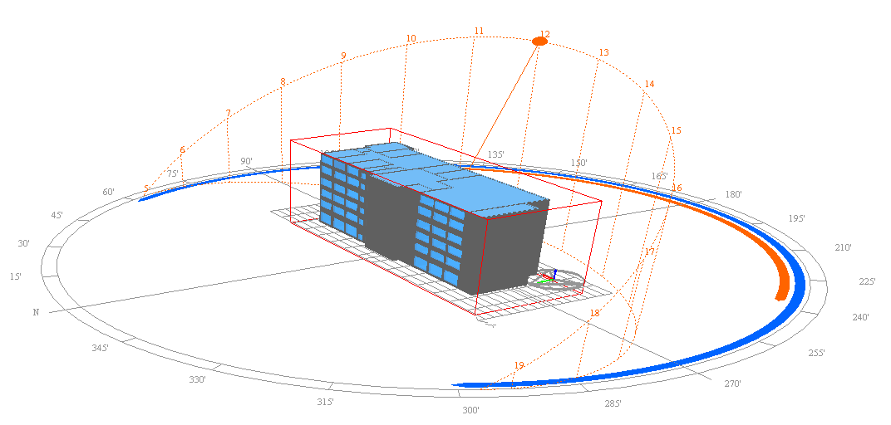

2、全年的阴影计算分析结果：

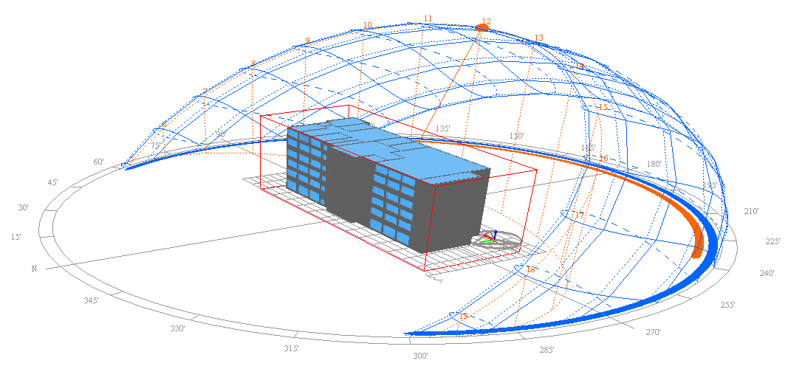

### 6、全年逐时冷负荷数据
以Excel文件的形式存放，全年冷/热负荷曲线图如下：
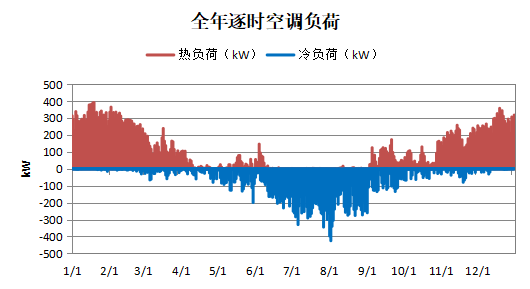
## 二、搭建离心式冷水机组模型
### 1、数据来源
建立离心式冷水机组物理模型，基于机组运行控制边界，获得机组运行工况边界约束，通过遍历所有工况参数，计算机组制冷量、COP、功率、蒸发温度、冷凝温度等性能参数，同时利用机组实际运行数据和实验室测试数据修正机组物理模型参数，获得机组最终数学模型，并进一步计算获得机组的全工况性能参数，为后续搭建机组机器学习模型做好准备。
### 2、冷冻水和冷却水温度范围
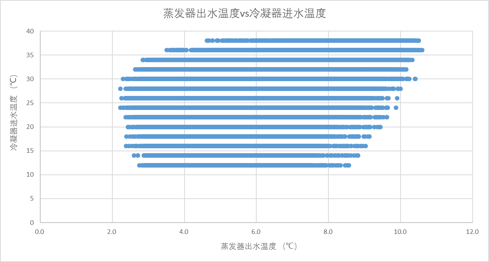
### 3、蒸发温度和冷凝温度范围
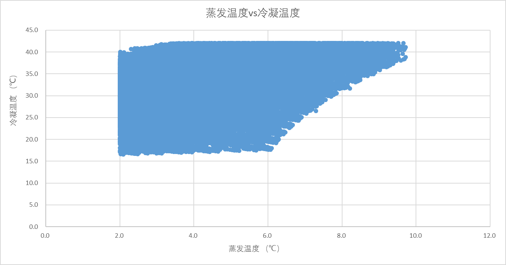
### 4、冷机部分负荷能效分布
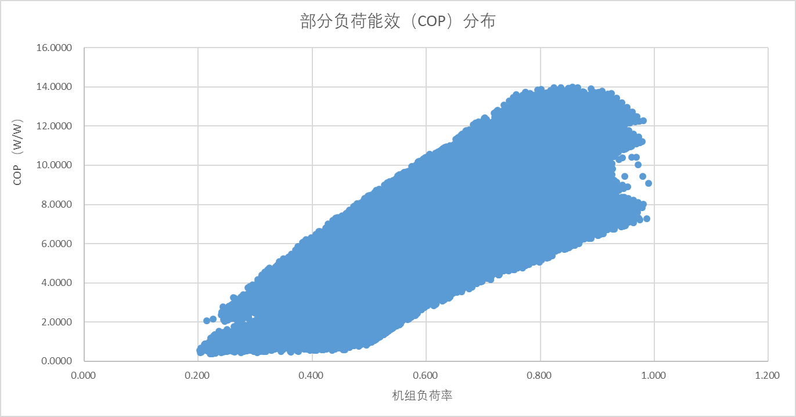
## 三、搭建冷冻/冷却水泵模型
### 1、数据来源
数据来自某国产水泵厂家选型手册中水泵特性曲线（包括扬程vs流量曲线和功率vs流量曲线）
### 2、水泵的扬程vs流量曲线
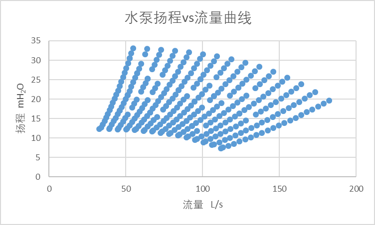
### 3、水泵的功率vs流量曲线
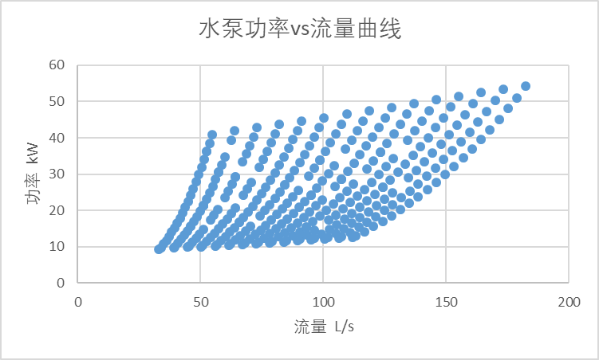
### 4、水泵最大流量和最大/最小扬程曲线
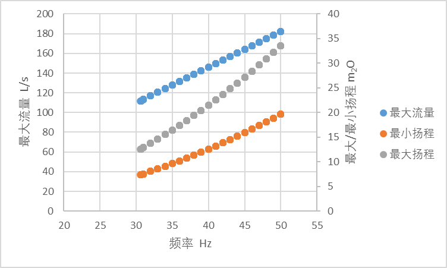

## 四、冷却塔模型
### 1、数据来源
数据来自冷却塔选型样本（进风干球/湿球温度、进水温度、水流量、风量 → 出水温度、风机功率），训练为 ML 代理模型，存放于 `src/algorithm/model_files/tower/`。
### 2、模型接口
输入 `(ta_dry_in, da_in, tw_in, Gw, Ga)`，输出 `(tw_out, P)`。模型参考设计点为 `Gw_r = 200 L/s`、`Ga_r = 58910 m³/h`；选型参数偏离参考点时按相似（亲和）定律做尺度换算，详见 `openspec/changes/simulation-result-contract/design.md` 的 D5。

## 五、仿真程序：数据契约与复现

### 1、输入数据契约
| 项 | 约定 |
|---|---|
| 首列 | 时间戳，规范化为 `YYYY-MM-DD HH:00` |
| 必需列语义 | 建筑冷负荷、室外干球温度、含湿量（按表头识别，不靠位置猜测） |
| 行数 | 全年逐时 8760 行；仿真周期 = 数据时间范围 |
| **负荷列量纲** | **kW**。系统**不做任何换算**，判定依据见 [docs/data-contract.md](docs/data-contract.md) |
| 内置样例 | `src/main/buildingload/buildingloads_adjusted.csv`（`datetime,t_dry,d,load`） |
| 路径解析 | 统一由 `src/algorithm/buildingload.py` 的 `data_file()` 给出 |

### 2、量纲与口径（口径版本 v2）
```
负荷单位      = kW（无换算）
实际单机容量  = 2112.6 kW × 冷机容量放大系数（默认 20）→ 42,252 kW
设计裕度      = 所有冷机实际容量之和 ÷ 建筑负荷最大值（只读派生）
合理区间      = 0.9 ~ 1.1
```
v1 曾用 `load_coe = 0.001`（把负荷当 W）叠加设备默认值 ÷26.58，本质是用两个系数掩盖"面积少记 1000 倍"这件事。v2 已全部废弃：负荷按 kW 直接计算，装机与负荷的匹配关系改由**设计裕度**显式表达，用户通过调整冷机台数把它控制在 0.9~1.1。

> `n_design_list`（加机优先级序列）必须与冷机台数一致，否则后端直接拒绝（422）——两者脱节会让群控按错误台数投运，而界面上看不出任何异常。

### 3、结果数据契约（七个区块）
| 区块 | 内容 |
|---|---|
| `meta` | 数据溯源、项目标识、口径版本、碳排因子、模型适用范围与外推统计、参数快照 |
| `summary` | 总能耗、总冷负荷、总供冷量、峰值、EUI、冷机平均 COP、系统能效、供冷缺口、碳排放 |
| `weekly` | 按日历周（ISO，周一起）聚合，含起止时间与实际小时数、分项能耗 |
| `monthly` | 按自然月聚合 |
| `breakdown` | 冷机 / 冷冻泵 / 冷却泵 / 冷却塔四分项，加和恒等于总耗电量 |
| `operating_stats` | 各类冷机累计投运小时数 |
| `peak_context` | 尖峰时刻及其冷负荷、系统能效、投运台数、冷机负荷率 |

### 4、碳排放口径
按《关于发布2023年电力二氧化碳排放因子的公告》（生态环境部、国家统计局，2025-12-31）取因子，配置见 `src/apiserver/app/config/emission_factors.json`（含 2022/2023 双年度、全国/区域/省级 30 省）。地理口径按「省级 → 区域 → 全国」逐级回退，实际命中的层级记入 `meta.carbonFactor`。

```
碳排放量 = 冷源站总耗电量 × 电力二氧化碳排放因子
```

### 5、环境要求
```
Python 3.12+（算法层使用 PEP 701 f-string）
torch, CoolProp, pandas, numpy     # 见 src/apiserver/requirements.txt
Windows 建议设置 PYTHONIOENCODING=utf-8（算法层会打印 emoji）
```

### 6、复现一次完整仿真
```bash
python scripts/verify_simulation.py
```
脚本会跑完内置数据的全年仿真，并核对三条可外部复核的结论：

1. `meta.totalHours` 等于输入数据行数（8760）
2. 四分项能耗之和等于总耗电量
3. 若供冷缺口大于 0，可定位到具体小时

实测输出（内置数据、默认选型，口径 v2）：
```
计算小时数 : 8760（输入 8760 行）    时间范围 : 2025-01-01 00:00 ~ 2025-12-31 23:00
空调面积   : 2,931,000 m²          冷机容量放大系数 : 20.0
总装机     : 316,890 kW            建筑负荷最大值 : 303,067 kW
设计裕度   : 1.0456（合理区间 0.9 ~ 1.1）   峰值强度 : 103.4 W/m²
建筑总冷负荷 149,646,120 kWh   冷源站总供冷量 147,919,588 kWh   总耗电量 30,891,996 kWh
冷机平均 COP 8.495             冷源站综合能效 4.788            EUI 10.540 kWh/m²
冷量强度 50.47 kWh/m²·yr       碳排放 17,157,415 kgCO₂（因子 0.5554，2023 年省级）
供冷缺口 0 kWh / 0 小时        停机未供冷 1,726,533 kWh
[PASS] 1. 总小时数 == 输入行数 / [PASS] 2. 分项加和 == 总耗电量 / [PASS] 3. 缺口为 0
```

### 7、一键启动（可选）

```powershell
.\scripts\dev.ps1                 # 同时起后端与前端，并打开浏览器
.\scripts\dev.ps1 -BackendOnly    # 只起后端（写接口 / 跑自检时用）
.\scripts\dev.ps1 -ApiPort 8001 -WebPort 5174
```

脚本会自动：选 Python 环境（优先 `github_HVAC`）→ 校验依赖 → 设置 `PYTHONIOENCODING=utf-8` →
启动后端并等其就绪 → 启动前端 → `Ctrl+C` 时一并结束子进程。后端日志写到 `data/logs/`。

> 改端口时注意：前端有两处地址写死为 8000（`.env.development` 的 `VITE_API_BASE_URL` 与
> `SimulationView.vue` 里的 WebSocket 地址），需同步修改，否则监控页收不到进度推送。

## 六、持久化与恢复

- **存储**：SQLAlchemy 2.0 async + SQLite（默认 `data/hvac.db`，WAL 模式）；`DATABASE_URL` 可切 MySQL（另装 `aiomysql`），业务代码无需改动
- **表**：`users / projects / datasets / simulation_tasks / simulation_results / reports / schema_migrations`
- **项目**：启动仿真时按（用户, 项目名）自动创建或复用项目，任务状态实时同步为项目状态；项目列表/详情返回最近一次仿真与结果摘要（总耗电量、EUI、碳排、峰值负荷）
- **输入数据**：落 `data/datasets/<sha256>.json`；同一内容重复提交按哈希去重，读取前校验指纹，被篡改即拒绝复现
- **结果**：七区块 JSON 与「已完成」状态在同一事务提交，不会出现"已完成但无结果"；重启后同一任务结果不变
- **报告**：`data/reports/` 仍是唯一产物，数据库只存索引；启动时自动回填历史报告，产物缺失时下载返回 404 并说明原因
- **启动顺序**：迁移（含 v2 一次性回填历史任务的项目关联） → 写入默认账户 → 未完成任务收敛为失败（服务重启中断） → 报告对账
- **删除项目**：从数据库删除项目行、解除任务关联，任务/结果/报告全部保留；回填只在迁移里执行一次，因此删除的项目不会因重启而复活

```powershell
# 在 src/apiserver 目录下执行（与 dev.ps1 的启动目录一致）
python -m app.db.migrate status        # 当前结构版本、已执行清单、待执行数量
python -m app.db.migrate upgrade       # 手动补齐迁移（等价于启动时的自动迁移）

# 在仓库根目录执行
python scripts/verify_persistence.py   # 持久化自检：迁移/种子/回填/并发隔离/重启恢复
```

行为变化：项目列表不再包含 3 条内置演示数据（新建项目会真正落库）；`GET /api/simulate/results` 的 `projectId` 在未关联项目时为 `0`；重启后未完成的任务显示为"失败：服务重启中断"，可点击"重新仿真"从留存数据重算。详见 [docs/persistence.md](docs/persistence.md)。

## 七、全年能耗仿真报告

### 1、报告构成（固定 7 章，单一标准模板）

| # | 章节 | 主要内容 |
|---|---|---|
| 1 | 封面与方案概览 | 项目名称、建筑类型、空调面积、仿真周期、计算小时数、报告版本与生成时间 |
| 2 | 输入数据与数据质量 | 数据文件、行数、确认的时间范围、修正的异常值数、干球温度与含湿量范围、冷机容量放大系数、口径版本 |
| 3 | 设备选型与群控参数 | 实际生效的参数快照；标注"仅展示"的参数及其标称值 → 模型值偏差；**选型尺度**小节给出设计裕度、容量放大系数、总装机与峰值负荷 |
| 4 | 全年能耗与能效结果 | 建筑总冷负荷、冷源站总供冷量、总耗电量、尖峰冷负荷、EUI、冷机平均 COP、系统能效、碳排放量；能耗构成图 |
| 5 | 时间维度分析 | 月度能耗柱状图、月度能效折线图、逐月与逐周明细表 |
| 6 | 运行工况分析 | 各机型累计投运小时、负荷率分布（10 个区间）、尖峰工况上下文 |
| 7 | 结论与口径说明 | 供冷缺口及其发生时刻、口径版本、碳排因子（值/层级/年度/来源）、模型适用范围与外推披露 |

报告为**自包含 HTML**：内联样式与 SVG 图表，不含 JavaScript、不含任何外部链接，可直接归档或打印为 PDF。

### 2、生成与下载

```
POST /api/reports/generate/{task_id}      生成报告，返回 report_id
GET  /api/reports/{report_id}             报告元信息（章节清单、生成时间、口径版本）
GET  /api/reports/download/{report_id}    下载报告 HTML（字节稳定）
GET  /api/reports/list/{task_id}          该任务的历史报告列表
```

界面入口：仿真完成后的监控页点击「生成报告」，跳转到 `/report/{report_id}`，可直接「打印 / 另存为 PDF」。

前置条件：任务必须已完成；缺少项目名称、空调面积、碳排因子、口径版本等关键字段时，生成会失败并**指名字段**，且不产生任何文件。

### 3、产物位置与留存

```
data/reports/<report_id>/
├── report.html      自包含报告正文（字节稳定）
├── result.json      生成时的七区块结果快照
└── meta.json        任务标识、归属用户、生成时间、口径版本、章节清单
```

文件仍是唯一产物；数据库的 `reports` 表只存索引（归属、生成时间、章节清单、产物路径与 sha256）。启动时扫描该目录回填索引，因此服务重启、甚至换一台机器恢复该目录后，仍可按 `report_id` 下载同一份报告；索引在库但产物被删时，下载返回 404 并说明原因。该目录已在 `.gitignore` 中排除。

### 4、关于「内容一致」的口径

报告需求要求"重复下载的内容完全相同"。本项目的口径是：

- **下载文件的字节一致**：同一 `report_id` 连续下载、以及服务重启后再次下载，`report.html` 的 sha256 完全相同（已实测）。
- **不承诺**两次"打印为 PDF"的产物字节一致——那是浏览器行为，分页会随打印驱动与纸张设置变化。

若日后需要"服务端直接产出 PDF 文件"，需另开 change（`design.md` 的 D1 记录了 reportlab 路线的取舍）。

## 八、账户与权限

- **账户存储**：`users` 表；角色分 `admin`（管理员）与 `engineer`（工程师）；首次启动写入 admin / user 两个默认账户（密码 123456）
- **个人账户**：右上角用户菜单 →「账户设置」，可修改邮箱、修改密码（需校验当前密码，至少 6 位且不能与旧密码相同）
- **用户管理**（仅管理员可见）：分页/搜索、新建账户、修改邮箱/角色/启用状态、重置密码、删除账户
- **保护规则**：不能修改自己的角色、不能停用或删除自己；至少保留一个启用状态的管理员；已有项目或仿真任务的账户不允许删除（请改为停用）；停用后立即无法登录
- **生效方式**：鉴权每次从数据库读取角色与启用状态，账户变更在下一次请求生效，无需重启；修改密码不会让已签发的令牌立即失效

```powershell
# 账户管理自检（24 项断言：鉴权、新建、改密、停用、重置、删除保护）
python scripts/verify_accounts.py
```

接口：`GET/POST /api/users`、`PATCH/DELETE /api/users/{id}`、`POST /api/users/{id}/password`、`PUT /api/auth/me`、`POST /api/auth/change-password`。

## 九、结果评价（雷达图）

仿真监控页的五维雷达图不再直接使用原始数值，而是把每个维度按国标/规范基准折算为 **0–100 分**：得分越高，点位越靠外，表示该维度表现越好；图内虚线为 60 分达标参考线，图下明细表给出原始值、得分、等级与评价基准。

| 维度 | 主要基准 |
|---|---|
| 综合平均能效 EERa | GB 50189-2015 冷源系统能效系数；GB 55015-2021；GB 19577-2024 冷机 IPLV |
| 全年冷机平均负荷率 | 冷源站总供冷量 ÷ Σ(在线冷机额定制冷量 × 1h)；GB 50189-2015 部分负荷性能要求（参考） |
| 单位面积供冷量 | GB/T 51161-2016 指标口径 + 办公建筑常规区间（参考） |
| 单位面积耗电量 | GB/T 51161-2016 办公建筑非供暖能耗约束/引导值，按冷源站约 35% 折算 |
| 单位面积碳排放 | GB/T 51366-2019 核算口径 + 地方低碳建筑碳排放限值，按冷源站约 35% 折算 |

分数按**当前基准**折算：基准或阈值更新后，历史结果的分数与等级会随之变化，结果数值本身不变。改造前生成的结果没有冷机平均负荷率字段，该维度显示“—（旧结果）”、不参与雷达绘制，并提示重新仿真。

完整分档阈值、折算假设与标准局限见 [docs/radar-benchmark.md](docs/radar-benchmark.md)。